# Laboratorio 07: Implementar CI/CD con Proyectos de Base de Datos SQL

**Objetivo:** Crear un proyecto de base de datos SQL local, añadir objetos (tablas y procedimientos), compilar el proyecto y configurar un pipeline de CI/CD utilizando GitHub Actions para automatizar su despliegue en Azure SQL Database.

## Paso 1: Configuración de Git y Autenticación en GitHub

Comenzamos configurando las credenciales globales de Git (nombre y correo electrónico) y nos autenticamos en GitHub utilizando la línea de comandos de GitHub (`gh auth login`).

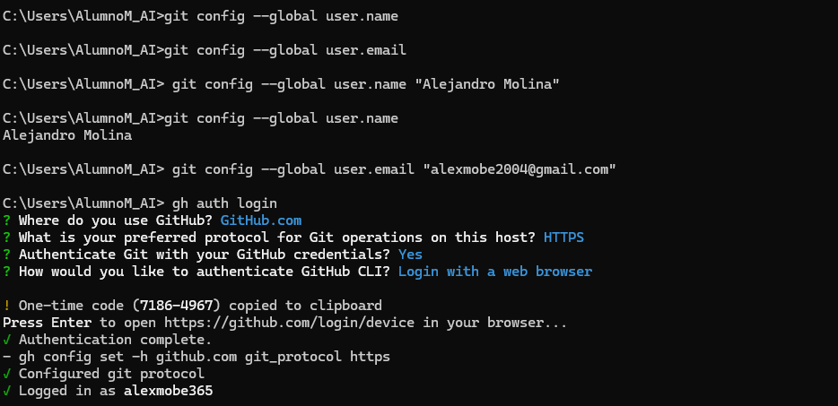

## Paso 2: Creación del Proyecto de Base de Datos

Utilizamos la herramienta de línea de comandos de .NET para crear un nuevo proyecto de base de datos SQL Server. Ejecutamos el comando `dotnet new sqlproj` especificando la plantilla para Azure SQL Database.

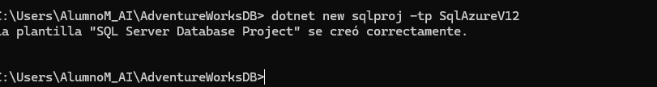

## Paso 3: Agregar Objetos al Proyecto (Tablas y Procedimientos)

Añadimos los scripts SQL que definirán la estructura de nuestra base de datos.
Primero, creamos la tabla `InventoryLog` definiendo sus columnas y tipos de datos.

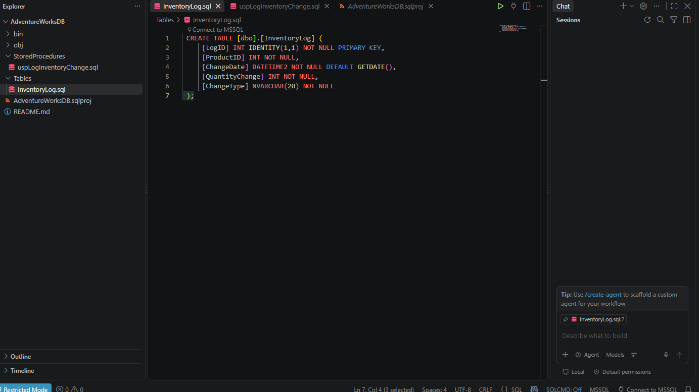

Luego, creamos el procedimiento almacenado `uspLogInventoryChange` que se encargará de insertar registros en la tabla que acabamos de crear.

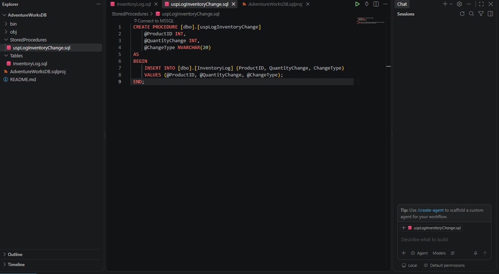

## Paso 4: Primera Compilación Local

Verificamos que no hay errores de sintaxis en nuestro código SQL compilando el proyecto localmente mediante el comando `dotnet build`. Esto genera el archivo `.dacpac`.

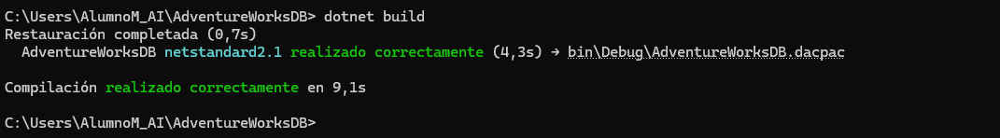

## Paso 5: Preparación del Control de Versiones

Antes de subir el código, creamos un archivo `.gitignore` para excluir las carpetas `bin/` y `obj/`. Estas carpetas contienen archivos compilados que no deben rastrearse en Git.

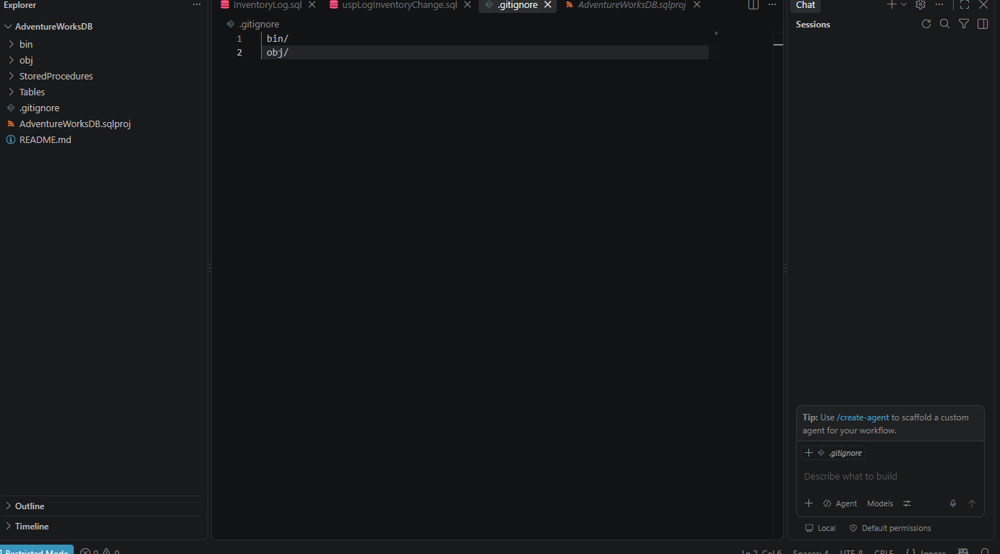

## Paso 6: Creación del Repositorio en GitHub

Utilizamos la CLI de GitHub para crear un nuevo repositorio privado y vincularlo directamente a nuestra carpeta local como el origen remoto (`origin`).

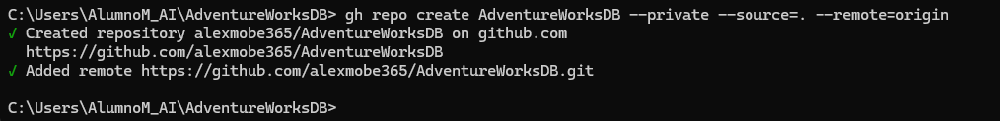

## Paso 7: Configuración de Secretos en GitHub

Para que GitHub Actions pueda conectarse y desplegar en nuestra base de datos de Azure de forma segura, configuramos la cadena de conexión como un secreto cifrado llamado `SQL_CONNECTION_STRING`.

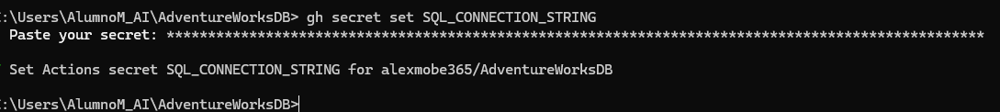

## Paso 8: Creación del Pipeline de CI/CD

Creamos el archivo de flujo de trabajo YAML (`build-deploy.yml`) en la carpeta `.github/workflows`. Este script automatizará la compilación y el despliegue a Azure SQL Database cada vez que se haga un `push` a la rama `main`.

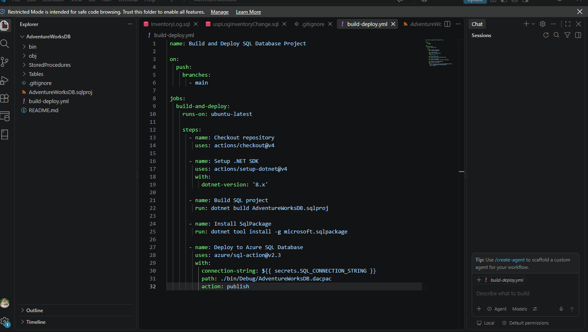

## Paso 9: Sincronización del Código (Commit y Push)

Confirmamos todos nuestros archivos (scripts, proyecto, gitignore y workflow) con un `git commit` y los enviamos a GitHub mediante `git push`. Esto desencadenará automáticamente el pipeline de GitHub Actions.

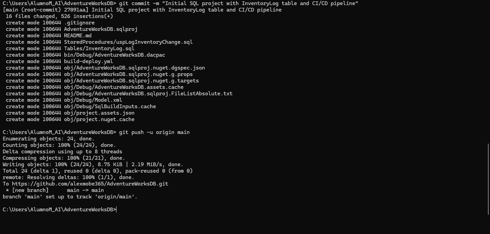

## Paso 10: Verificación del Repositorio

Comprobamos en la interfaz web de GitHub que todos los archivos se han subido correctamente a la rama principal.

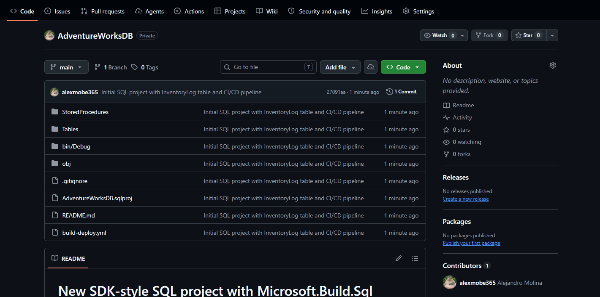

## Paso 11: Verificación y Consultas en la Base de Datos

Para verificar que la estructura se ha desplegado (o comprobar su estado), realizamos varias consultas a los esquemas de información (`INFORMATION_SCHEMA`) desde el editor de consultas.

Consultamos la vista `TABLES` para buscar nuestra nueva tabla `InventoryLog`:

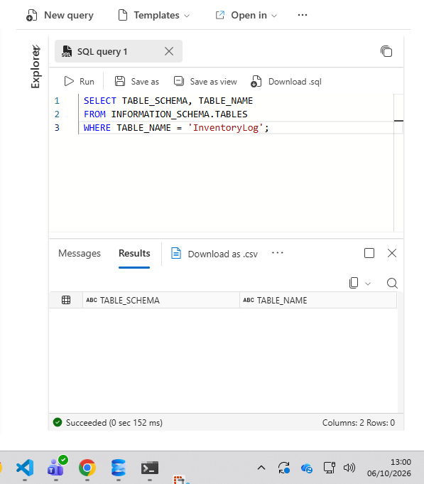

Consultamos la vista `ROUTINES` para buscar nuestro procedimiento almacenado `uspLogInventoryChange`:

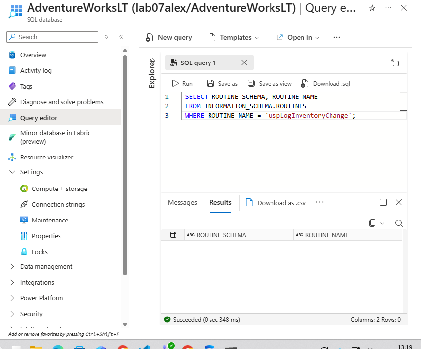

En caso de requerir validaciones adicionales o actualizaciones, volvemos a realizar una compilación local del proyecto para asegurar que los últimos cambios sean válidos:

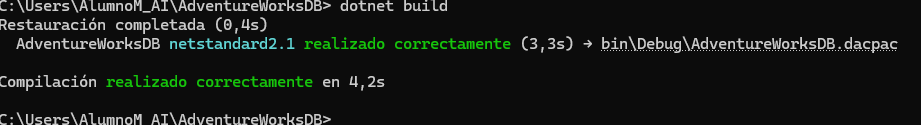

Finalmente, consultamos la vista `COLUMNS` para revisar la estructura exacta y los tipos de datos creados para la tabla `InventoryLog`:

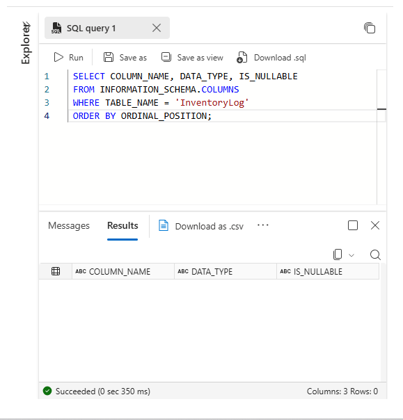

**Conclusión del Laboratorio:**
Hemos logrado establecer con éxito un ciclo de Integración y Despliegue Continuo. El código SQL ahora reside en un repositorio con control de versiones y cualquier cambio futuro será compilado y desplegado de forma automática y estandarizada gracias a GitHub Actions.